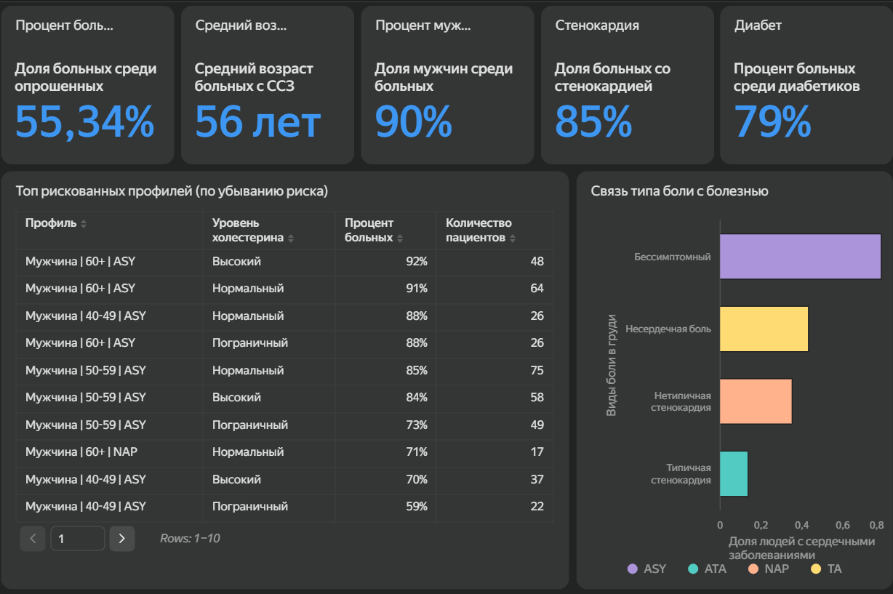

# Дашборд: Анализ риска сердечных заболеваний (DataLens & Dash)

Проект посвящен визуализации медицинских данных для прогнозирования сердечно-сосудистых заболеваний. В рамках работы были построены два дашборда с использованием разных инструментов: **Yandex DataLens** (Low-Code BI) и **Dash** (Python-фреймворк для веб-приложений).

**Датасет:** `heart_processed.csv` (Heart Failure Prediction Dataset). Данные были предварительно очищены и закодированы, поэтому основной фокус работы был направлен на аналитику, написание формул и проектирование интерфейса.

---

## 1. Интерактивный дашборд в Yandex DataLens

**[Ссылка на дашборд в DataLens](https://datalens.ru/shw45f9ghur4c-analiz-riska-serdechnyh-zabolevaniy)**



Дашборд в DataLens предназначен для детального анализа факторов риска и сегментации пациентов. 

### Ключевые индикаторы (KPI)
На панели слева выведены основные метрики, которые сразу дают общую картину по выборке:
*   **Общая доля больных:** 55.34% (от всех опрошенных).
*   **Процент больных среди диабетиков:** 79% (сильная корреляция диабета и ССЗ).
*   **Процент больных среди людей со стенокардией:** 85%.
*   **Доля мужчин среди больных:** 90%.
*   **Средний возраст больных:** 56 лет.

### Визуализации
*   **Таблица топ-рискованных профилей:** отсортированный список комбинаций (Пол, Возрастная группа, Уровень холестерина) с наибольшим процентом больных.
*   **Столбчатая диаграмма (Виды болей в груди):** распределение типов боли (бессимптомная, несердечная, нетипичная, типичная стенокардия) в разрезе наличия заболевания.
*   **Диаграмма рассеяния (Scatter plot):** зависимость максимального пульса от депрессии сегмента ST. Цветом выделены больные и здоровые.
*   **Столбчатые диаграммы:** распределение больных по возрастным группам с разбивкой по полу, а также связь повышенного артериального давления с возрастом и болезнью.
*   **Круговая диаграмма:** соотношение типов болей в груди.

Для всех графиков настроены интерактивные фильтры, цветовые схемы и всплывающие подсказки.

### Вычисляемые поля (Calculated Fields)
Вся аналитика строится на вычисляемых полях, созданных внутри DataLens. В репозитории они хранятся в виде формул (синтаксис DataLens).

**Категоризация возраста (`Age_Group`):**
```sql
IF [Age] < 40 THEN '<40 лет'
ELSEIF [Age] >= 40 AND [Age] < 50 THEN '40-49 лет'
ELSEIF [Age] >= 50 AND [Age] < 60 THEN '50-59 лет'
ELSE '60+ лет'
END
```

**Уровень холестерина (`Cholesterol_Level`):**
```sql
IF [Cholesterol] = 1 THEN 'Нормальный' ELSE 'Высокий' END
```

**Категория давления (`BP_Category`):**
```sql
IF [Resting BP] >= 140 THEN 'Повышенное' ELSE 'Нормальное' END
```

**Текстовое описание статуса (`HeartDiseaseWords`):**
```sql
IF [Heart Disease] = 1 THEN 'Больные' ELSE 'Здоровые' END
```

**Профиль пациента (`Profile`):**
```sql
CONCAT([Sex], ' | ', [Age_Group], ' | ', [Cholesterol_Level])
```

**Метрика «Средний возраст больных» (`Avg_Age_Sick`):**
```sql
AVG_IF([Heart Disease] = 1, [Age])
```

**Метрика «Процент больных»:** рассчитывается через `AVG_IF` (возвращает 1, если больной, и 0, если здоровый, затем усредняет) или `COUNT_IF`.

**Метрика «Количество уникальных профилей»:**
```sql
COUNTD([Profile])
```

---

## 2. Прототип дашборда на Dash (Python)

**[Ссылка на Google Colab с кодом Dash](https://colab.research.google.com/drive/1Ao9DCyP-WpRcOLfxQ-GeE1-8LE_0jI6E?usp=sharing#scrollTo=ipPT8sk2PhTN)**

Dash использовался как альтернативный инструмент для построения кастомного веб-приложения на Python. 

В рамках этого этапа был реализован интерфейс с использованием `dash`, `plotly` и `pandas`:
*   **HTML-разметка:** Заголовки, блоки со сводной статистикой (всего пациентов, количество больных).
*   **Круговая диаграмма (Pie chart):** Соотношение здоровых и больных пациентов.
*   **Диаграмма рассеяния (Scatter plot):** Взаимосвязь возраста и давления (с цветовым разделением по наличию болезни).
*   **Интерактивная таблица (DataTable):** Вывод данных с постраничной навигацией.

*Примечание:* Для быстрой отладки интерфейса в Colab использовался сэмпл из 10 записей, чтобы продемонстрировать работу компонентов Dash без нагрузки на среду выполнения.

---

## Процесс разработки (DataLens)

1.  **Подготовка данных.** Исходный CSV-файл был загружен в DataLens. Числовые признаки приведены к нужным типам, категориальные (пол, тип боли) — к строкам.
2.  **Создание вычисляемых полей.** Написаны формулы для группировки возрастов, категоризации холестерина, давления и склейки текстовых профилей.
3.  **Построение чартов.** Для каждого виджета выбран подходящий тип визуализации. Настроены оси, легенды и агрегации (`SUM`, `AVG`, `COUNTD`).
4.  **Сборка дашборда.** Чарты и индикаторы размещены на одном экране. Настроены связи (links) между виджетами, чтобы при клике на возрастную группу обновлялись остальные графики.
5.  **Оформление.** Настроена темная тема, выбрана контрастная цветовая палитра (синий для мужчин, розовый для женщин, зеленый/красный для статуса болезни), добавлены заголовки.

---

## Стек технологий
*   **BI-инструмент:** Yandex DataLens (Calculated fields, агрегации `AVG_IF`, `COUNT_IF`, `COUNTD`, интерактивные фильтры, дашбординг).
*   **Python:** Pandas, Plotly, Dash.
*   **Среда:** Yandex DataLens, Google Colab.
