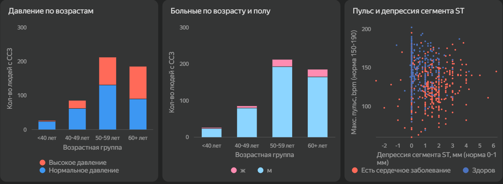

# Дашборд: Анализ риска сердечных заболеваний (DataLens & Dash)

Проект посвящен визуализации медицинских данных для прогнозирования сердечно-сосудистых заболеваний. В рамках работы были построены два дашборда с использованием разных инструментов: **Yandex DataLens** (Low-Code BI) и **Dash** (Python-фреймворк для веб-приложений).

## Данные
Исходный датасет находится в файле [`data/heart.csv`](data/heart.csv). 
Это популярный датасет **Heart Failure Prediction Dataset** (доступен на Kaggle). Он объединяет данные из пяти различных исследований и содержит 11 клинических признаков, включая:
*   **Демография:** Возраст (`Age`), Пол (`Sex`).
*   **Показатели здоровья:** Артериальное давление (`RestingBP`), Холестерин (`Cholesterol`), Максимальный пульс (`MaxHR`).
*   **Симптомы и ЭКГ:** Тип боли в груди (`ChestPainType`), результаты ЭКГ (`RestingECG`), депрессия сегмента ST (`Oldpeak`), наклон сегмента ST (`ST_Slope`).
*   **Целевая переменная:** `HeartDisease` (1 — есть заболевание, 0 — здоров).

---

## 1. Интерактивный дашборд в Yandex DataLens

**[Ссылка на дашборд в DataLens](https://datalens.ru/shw45f9ghur4c-analiz-riska-serdechnyh-zabolevaniy)**




Дашборд в DataLens предназначен для детального анализа факторов риска и сегментации пациентов. 

### Ключевые индикаторы (KPI)
На панели сверху выведены основные метрики, которые сразу дают общую картину по выборке:
*   **Общая доля больных:** 55.34% (от всех опрошенных).
*   **Процент больных среди диабетиков:** 79% (сильная корреляция диабета и ССЗ).
*   **Процент больных со стенокардией:** 85%.
*   **Доля мужчин среди больных:** 90%.
*   **Средний возраст больных:** 56 лет.

### Визуализации
*   **Таблица топ-рискованных профилей:** отсортированный список комбинаций (Пол, Возрастная группа, Уровень холестерина) с наибольшим процентом больных.
*   **Столбчатая диаграмма (Виды болей в груди):** распределение типов боли (бессимптомная, несердечная, нетипичная, типичная стенокардия) в разрезе наличия заболевания.
*   **Диаграмма рассеяния (Scatter plot):** зависимость максимального пульса от депрессии сегмента ST. Цветом выделены больные и здоровые.
*   **Столбчатые диаграммы:** распределение больных по возрастным группам с разбивкой по полу, а также связь повышенного артериального давления с возрастом и болезнью.

### Дизайн и UX/UI-принципы
При проектировании дашборда мы опирались на классические правила визуализации данных (data-ink ratio, иерархия, доступность), чтобы снизить когнитивную нагрузку на пользователя:

*   **Доступность (Accessibility).** Отказались от классической красно-зеленой палитры для статуса болезни в пользу контрастных сине-оранжевых оттенков. Это базовое требование, так как красно-зеленый спектр неразличим для людей с дальтонизмом.
*   **Снижение визуального шума.** На графиках убраны линии сетки (grid lines), а на осях оставлены только необходимые подписи. Согласно принципу data-ink ratio, ничто не должно отвлекать от самих данных.
*   **Статистическая достоверность.** В таблице топ-профилей добавлен фильтр по количеству пациентов (от 15 человек). Это защита от статистического шума, когда группа из одного человека дает ложные 100% риска.
*   **Иерархия и композиция.** Элементы выстроены по Z-паттерну: самое важное (KPI-карточки) — наверху, детализация (таблица, распределение) — ниже. Все виджеты выровнены по единой модульной сетке.
*   **Удобство чтения.** Для столбчатых диаграмм включены подписи данных (data labels) прямо на столбцах, чтобы пользователю не приходилось сканировать ось Y глазами.

### Вычисляемые поля (Calculated Fields)
Вся аналитика строится на вычисляемых полях, созданных внутри DataLens. В репозитории они хранятся в виде формул (синтаксис DataLens).

**Категоризация возраста (`Age_Group`):**
```sql
IF [Age] < 40 THEN '<40 лет'
ELSEIF [Age] >= 40 AND [Age] < 50 THEN '40-49 лет'
ELSEIF [Age] >= 50 AND [Age] < 60 THEN '50-59 лет'
ELSE '60+ лет'
END
```

**Уровень холестерина (`Cholesterol_Level`):**
```sql
IF [Cholesterol] = 1 THEN 'Нормальный' ELSE 'Высокий' END
```

**Категория давления (`BP_Category`):**
```sql
IF [Resting BP] >= 140 THEN 'Повышенное' ELSE 'Нормальное' END
```

**Текстовое описание статуса (`HeartDiseaseWords`):**
```sql
IF [Heart Disease] = 1 THEN 'Больные' ELSE 'Здоровые' END
```

**Профиль пациента (`Profile`):**
```sql
CONCAT([Sex], ' | ', [Age_Group], ' | ', [Cholesterol_Level])
```

**Метрика «Средний возраст больных» (`Avg_Age_Sick`):**
```sql
AVG_IF([Heart Disease] = 1, [Age])
```

**Метрика «Процент больных»:** рассчитывается через `AVG_IF` (возвращает 1, если больной, и 0, если здоровый, затем усредняет) или `COUNT_IF`.

**Метрика «Количество пациентов» (для фильтрации):**
```sql
COUNT([Profile])
```

---

## 2. Прототип дашборда на Dash (Python)

**[Ссылка на Google Colab с кодом Dash](https://colab.research.google.com/drive/1Ao9DCyP-WpRcOLfxQ-GeE1-8LE_0jI6E?usp=sharing#scrollTo=ipPT8sk2PhTN)**

Dash использовался как альтернативный инструмент для построения кастомного веб-приложения на Python. 

В рамках этого этапа был реализован интерфейс с использованием `dash`, `plotly` и `pandas`:
*   **HTML-разметка:** Заголовки, блоки со сводной статистикой (всего пациентов, количество больных).
*   **Круговая диаграмма (Pie chart):** Соотношение здоровых и больных пациентов.
*   **Диаграмма рассеяния (Scatter plot):** Взаимосвязь возраста и давления (с цветовым разделением по наличию болезни).
*   **Интерактивная таблица (DataTable):** Вывод данных с постраничной навигацией.

*Примечание:* Для быстрой отладки интерфейса в Colab использовался сэмпл из 10 записей, чтобы продемонстрировать работу компонентов Dash без нагрузки на среду выполнения.

---

## Ключевой аналитический вывод
В ходе анализа (на основе отфильтрованных статистически значимых профилей) удалось выявить четкий паттерн: **наибольший риск (от 84% до 92%) наблюдается у мужчин старше 50 лет с бессимптомным типом боли в груди (ASY)**. Это показывает, что отсутствие явных клинических симптомов создает ложное чувство безопасности, хотя именно эта демографическая группа находится в зоне максимального риска.

---

## Стек технологий
*   **BI-инструмент:** Yandex DataLens (Calculated fields, агрегации `AVG_IF`, `COUNT_IF`, `COUNTD`, интерактивные фильтры, дашбординг).
*   **Python:** Pandas, Plotly, Dash.
*   **Среда:** Yandex DataLens, Google Colab.
